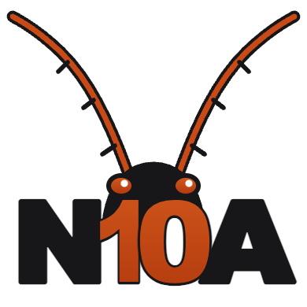

# N10A

N10A is a private journal you share with people you have added. You add someone by photographing their code.

**[Download the latest release](https://github.com/tonycowan/N10A/releases/latest)**

Releases include macOS, Linux, Windows, and an Android app.

Unsigned packages are built on [tonycowan/Prns](https://github.com/tonycowan/Prns) by `optio-macos-package`, `optio-linux-package`, `optio-windows-package`, and `optio-android-package`. The release workflow here downloads one successful run of each, checks that they share one Prns commit, Developer ID-signs the macOS apps, and can publish a GitHub Release.
